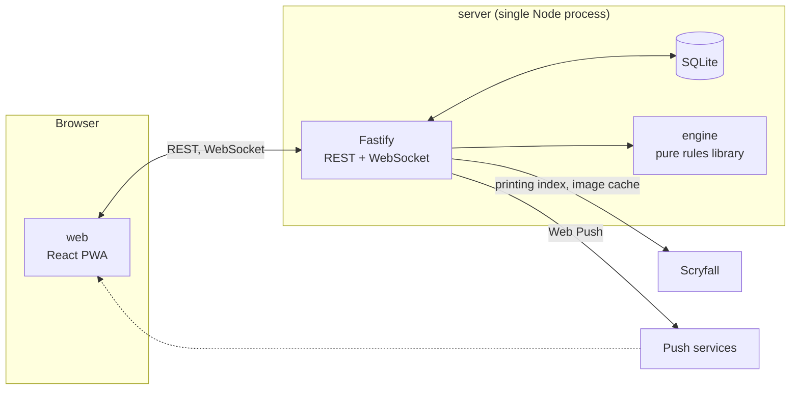

# Basic Land Game

A two-player, installable web app (PWA) for the **Basic Land Game**, a minimalist card game in which both players play only basic lands from a deck of 50 and try to be the first to control a "domain" (one of each of the five land types) or a "mono" (five lands of one type). The rules come from Skura's article "Basic Land Game" on ultimateguard.com.

Players join through an invite link, no accounts needed. The server runs the rules, so neither player can cheat or see the other's hidden cards. Land art comes from [Scryfall](https://scryfall.com), and each player can pick their own printings.

## Features

- Online play for two people on phone or desktop browsers, installable as a PWA
- Invite links and rejoin links, with sessions that survive reloads, connection loss and server restarts
- Sound, vibration and Web Push notifications when it is your turn or you can counter
- Per-player custom land art through a Scryfall gallery, with bundled default art that works offline
- Configurable game options: deck size, empty-library rule, turn limit, first player
- Self-hosted on a Raspberry Pi with Docker and nginx

## Quick start

Requires Node.js 22 or newer.

```sh
npm install
npm test                          # engine, server and web unit/component tests

npm run dev -w basic-land-server  # API and WebSocket on http://localhost:3000
npm run dev -w basic-land-web     # Vite dev server on http://localhost:5173
```

The Vite dev server proxies `/api`, `/img` and `/ws` to port 3000. Open <http://localhost:5173> to play.

Other useful commands:

```sh
npm run typecheck                           # all workspaces
npm run build -w basic-land-web             # production web build in web/dist
npm run build -w basic-land-server          # server bundle in server/dist
cd web && npx playwright test               # end-to-end tests (builds the app and starts the server itself)
docker compose -f deploy/docker-compose.yml build
```

## Architecture

The repo is an npm workspaces monorepo with three packages. Dependencies only point inwards: `web` and `server` depend on `engine`, and `engine` knows nothing about either.



| Package | Purpose | Main technologies |
|---|---|---|
| [`engine/`](engine) | Pure, deterministic rules engine: state machine, legal actions, per-seat views. No IO or UI. | TypeScript, seeded RNG, Vitest |
| [`server/`](server) | Authoritative game server: REST and WebSocket API, persistence, Scryfall proxy and image cache, Web Push, cleanup jobs. Also serves the built web app. | Node 22, Fastify 5, `better-sqlite3`, `zod`, `web-push` |
| [`web/`](web) | The client: lobby, table, art picker, notifications, i18n. Renders only what the server sends. | React 19, Vite, Zustand, Tailwind CSS, `vite-plugin-pwa`, Playwright |

Key design decisions:

- **The server is authoritative.** Clients send actions, the server validates them with the engine and broadcasts per-seat views. The seed, libraries and the opponent's hand never leave the server.
- **State is the config plus the list of applied actions.** The engine is deterministic, so the server rebuilds a game by replay after a restart. Each game stores a `RULES_VERSION`, so games from incompatible rule versions are abandoned instead of replayed wrongly.
- **One container, one process.** Fastify serves the web app, API, WebSocket and image proxy. nginx only terminates TLS.

Full details are in [`specs/web/11-architecture.md`](specs/web/11-architecture.md) (web and server) and [`specs/04-architecture.md`](specs/04-architecture.md) (engine).

### Repository layout

```
engine/    rules engine (src/, test/)
server/    Fastify server (src/, test/); SQLite data lives in server/data (git-ignored)
web/       React PWA (src/, test/, e2e/, public/ with bundled art, fonts and icons)
specs/     rules, API and product specs, Gherkin scenarios
deploy/    docker-compose.yml, nginx example, healthcheck, .env.example
scripts/   fetch-default-art.mjs, make-icons.mjs (developer tools)
Dockerfile multi-stage image for linux/arm64 and amd64
DEPLOY.md  step-by-step Raspberry Pi guide
```

## Development process

The project is spec-driven. The specs in [`specs/`](specs) are the source of truth: change the spec first, then the tests, then the code. Every rule has an ID (`R-xx`), every Gherkin scenario in [`specs/features/`](specs/features) is tagged with the rules it covers, and every scenario becomes one Vitest test. See [`specs/README.md`](specs/README.md) for the full process.

Developer tools:

- `node scripts/fetch-default-art.mjs` re-downloads the default art from Scryfall.
- `node scripts/make-icons.mjs` redraws the PWA icons.

## Documentation

**Game and engine**

| Document | Contents |
|---|---|
| [`specs/README.md`](specs/README.md) | Spec index and development process |
| [`specs/01-rules.md`](specs/01-rules.md) | Normative game rules with IDs and config options |
| [`specs/02-glossary.md`](specs/02-glossary.md) | Shared vocabulary |
| [`specs/03-engine-api.md`](specs/03-engine-api.md) | Public engine API: config, state, actions, events |
| [`specs/04-architecture.md`](specs/04-architecture.md) | Engine stack, layout and testing approach |
| [`specs/05-open-questions.md`](specs/05-open-questions.md) | Unresolved rules and decisions |

**Web app**

| Document | Contents |
|---|---|
| [`specs/web/10-product.md`](specs/web/10-product.md) | Product requirements |
| [`specs/web/11-architecture.md`](specs/web/11-architecture.md) | Packages, stack, persistence, security |
| [`specs/web/12-protocol.md`](specs/web/12-protocol.md) | REST and WebSocket protocol |
| [`specs/web/13-images.md`](specs/web/13-images.md) | Scryfall index and image cache |
| [`specs/web/14-notifications.md`](specs/web/14-notifications.md) | Web Push and in-app cues |
| [`specs/web/15-deployment.md`](specs/web/15-deployment.md) | Deployment decisions: Raspberry Pi, Docker, nginx |

**Operations**

| Document | Contents |
|---|---|
| [`DEPLOY.md`](DEPLOY.md) | Step-by-step deployment, operations and troubleshooting |
| [`deploy/.env.example`](deploy/.env.example) | Server configuration variables |
| [`deploy/docker-compose.yml`](deploy/docker-compose.yml) | Compose service definition |
| [`deploy/nginx.example.conf`](deploy/nginx.example.conf) | nginx reverse-proxy example |

Gherkin scenarios: [engine](specs/features) (`setup-and-turns`, `land-effects`, `counter-and-winning`) and web (`web-art`, `web-notifications`, `web-sessions`), all in the same folder.

## Deployment

The app ships as a single Docker image. To self-host it, follow [`DEPLOY.md`](DEPLOY.md). It covers preparing the Pi, a DuckDNS hostname, building the image, VAPID keys for push notifications, nginx with Let's Encrypt, and verification. Copy [`deploy/.env.example`](deploy/.env.example) to `deploy/.env` and fill it in. The real `.env` is git-ignored and must never be committed.

## Credits

- Game design: Skura, "Basic Land Game" (ultimateguard.com).
- Card art and data: [Scryfall](https://scryfall.com). Default art is Rebecca Guay's Foundations printings. Magic: The Gathering is a trademark of Wizards of the Coast. This project is unofficial fan work.
- UI: [shadcn/ui](https://ui.shadcn.com) and 8bitcn/ui components (MIT), Pixelify Sans font.

## License

No license file has been added yet. Until one is, all rights are reserved by the author.
